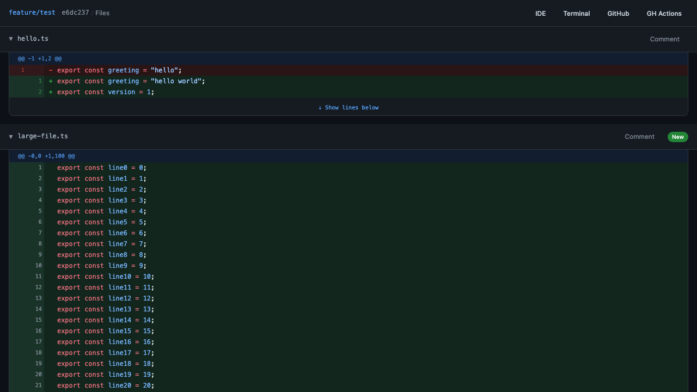
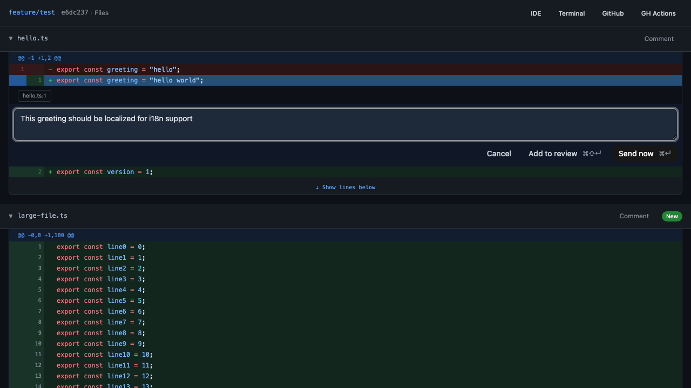
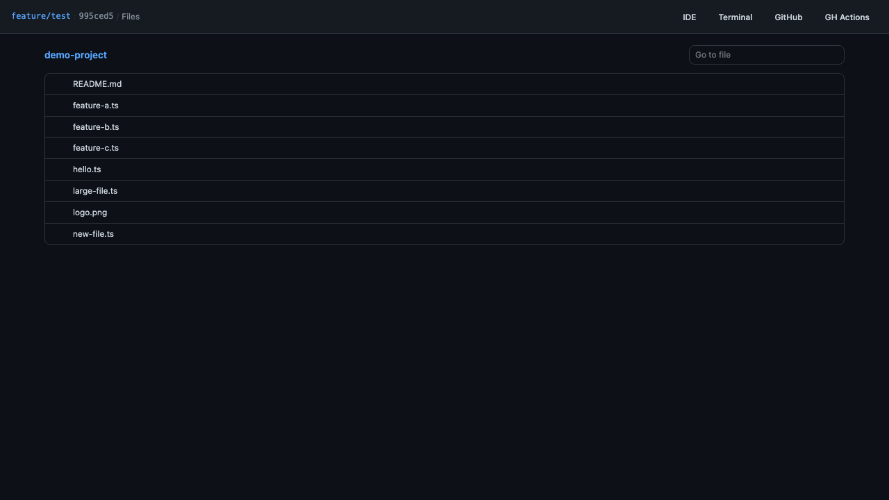
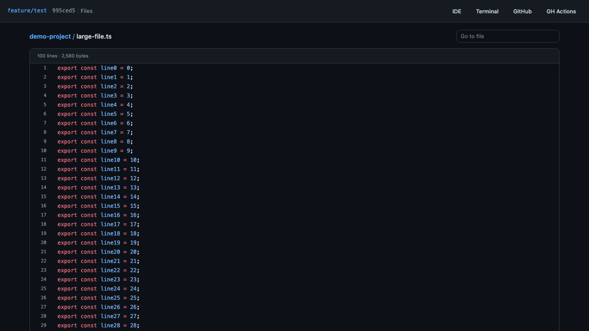
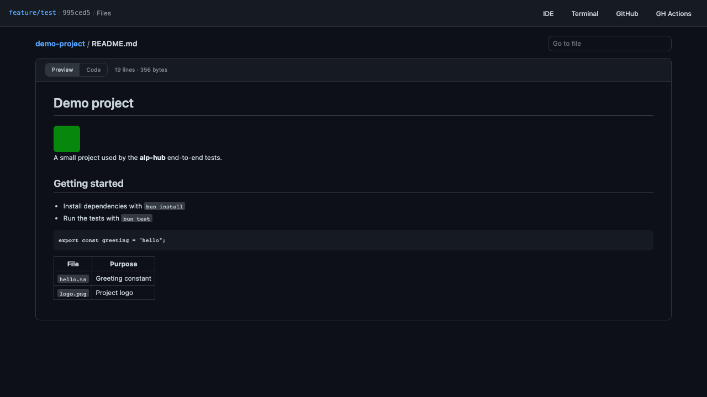
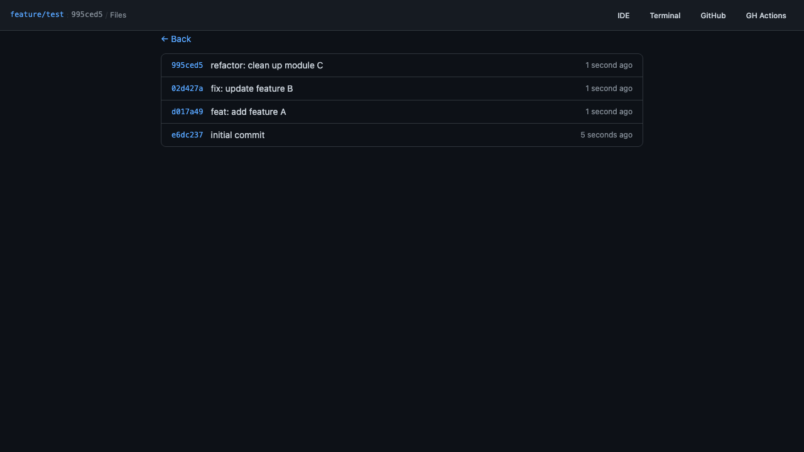
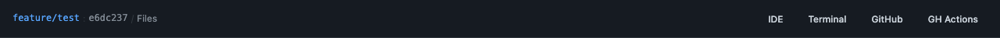

# alp-hub

> **alp-hub is a fork of [azu/cmux-hub](https://github.com/azu/cmux-hub)**. It is not the official cmux-hub and is not supported by its author. See [About this fork](#about-this-fork).

A browser-based diff viewer and repository browser for [cmux](https://cmux.dev). See what changed at a glance with syntax-highlighted diffs, inline review comments, a GitHub-style file browser with README previews, GitHub PR status and toolbar shortcuts, all streamed in real time via WebSocket.

The binary, CLI and internal identifiers keep the `cmux-hub` name.

## About this fork

alp-hub is forked from [cmux-hub](https://github.com/azu/cmux-hub) 1.6.0 by azu (MIT licence). It adds:

- A GitHub-style **Files** page with README (markdown) preview and image display
- The short HEAD commit next to the branch in the toolbar, and a smaller toolbar and code font
- A default menu with IDE, Terminal, GitHub and GH Actions buttons
- Updated dependencies (React 19.3, TypeScript 7, lucide-react 1.x and others)

Fixes that apply upstream too are proposed back to cmux-hub (open pull requests): [azu/cmux-hub#22](https://github.com/azu/cmux-hub/pull/22) (exit cleanly outside a git repository) and [azu/cmux-hub#23](https://github.com/azu/cmux-hub/pull/23) (dependency update).

## Screenshots

### Diff View

Syntax-highlighted diff with add/delete coloring and line numbers.



### Inline Review Comments

Select lines and write review comments that are sent to the cmux terminal.



### Files

Browse the repository like on GitHub: a path breadcrumb, folders first, then files. Gitignored files are hidden and files with uncommitted changes are marked with ●. "Go to file" searches every path.



Click a file to view it with line numbers and syntax highlighting.



### README Preview

Markdown files open in a rendered **Preview** with a **Code** toggle for the raw source. Images (png, jpg, gif, webp, svg, ico, bmp) are displayed directly.



### Commit History

Browse recent commits when no pending changes are detected, or open `#/commits`.



### Toolbar

Branch name and short HEAD commit, the Files link, and the action buttons (IDE, Terminal, GitHub, GH Actions).



Update screenshots: `bun run screenshots`

## Features

- Diff view with syntax highlighting (Shiki)
- GitHub-style file browser with markdown (README) preview and image display
- Branch and short HEAD commit in the toolbar
- Real-time diff updates via WebSocket
- Untracked and unstaged file detection
- Commit history browser (when no pending changes)
- Plan file viewer (Claude Code session plans with syntax highlighting)
- Branch selector for switching diff base
- Hash-based URL routing with browser back/forward support
- Custom toolbar actions via JSON (with submenu support)
- File watcher with auto-refresh (working tree + git ref changes)
- Inline review comments sent to cmux terminal
- GitHub PR integration (CI status, PR review comments)
- WebSocket real-time updates (diff changes, PR/CI polling)
- Self-update command (`cmux-hub update`)
- Auto-shutdown when browser tab closes
- Git worktree support
- Exits with a clear error when the target directory is not a git repository

## Prerequisites

cmux-hub connects to the cmux Unix socket (`/tmp/cmux.sock`). The default socket mode only allows cmux child processes to connect.

If you launch cmux-hub from within cmux (e.g. Claude Code commands, terminal shell), the default mode works. If you launch from an external process (Alfred, Raycast, Karabiner Elements, etc.), set **Automation mode**:

> cmux Settings → Automation → Socket Control Mode → **Automation mode**

Or set `CMUX_SOCKET_MODE=allowAll`.

## Install

alp-hub has no release binaries yet. Build it from source:

```bash
git clone https://github.com/vparmeland/cmux-hub.git alp-hub
cd alp-hub
git checkout alp-hub
bun install
bun run build:compile
mkdir -p ~/.local/bin
cp cmux-hub ~/.local/bin/cmux-hub
```

`cmux-hub update` and the bundled Claude Code plugin still download upstream cmux-hub releases from `azu/cmux-hub`, which replace this build.

## Usage

```bash
# Run (diff of current directory)
cmux-hub

# Specify target directory
cmux-hub /home/user/project

# Custom toolbar actions
cmux-hub --actions actions.json

# Read actions from stdin
cat actions.json | cmux-hub --actions -
```

When run without `target_dir` from a linked Git worktree, cmux-hub watches that worktree even
if cmux reports a different focused working directory.

The target directory must be inside a git repository. Otherwise cmux-hub prints
`cmux-hub: not a git repository: <dir>` and exits with code 1.

### Usage with cmux + Claude Code

When launched inside cmux, cmux-hub automatically opens a browser split pane and shuts down when the pane closes.

#### Plugin (recommended)

Install as a Claude Code plugin. This auto-installs the binary, sets up SessionStart hooks, and copies default actions to `~/.claude/cmux-hub.json`. Project-local `.claude/cmux-hub.json` takes priority if present.

```bash
claude plugin marketplace add azu/cmux-hub
claude plugin install cmux-hub@cmux-hub-marketplace
```

The first session start downloads the binary, so it may take a few seconds to launch.

Update the plugin:

```bash
claude plugin update cmux-hub@cmux-hub-marketplace
```

#### Manual setup

`.claude/cmux-hub.json`:

```json
[
  { "label": "IDE", "type": "shell", "command": "code \"$CMUX_HUB_CWD\"" },
  {
    "label": "Terminal",
    "type": "shell",
    "command": "PANE=$(cmux --json list-panes | jq -r --arg sid \"$CMUX_HUB_SURFACE_ID\" '.panes[] | select(any(.surface_refs[], .surface_ids[]; . == $sid)) | .ref') && cmux new-surface --type terminal --pane \"$PANE\" --working-directory \"$CMUX_HUB_CWD\" --focus true"
  },
  { "label": "GitHub", "type": "shell", "command": "/usr/bin/open \"$(gh browse -n)\"" },
  { "label": "GH Actions", "type": "shell", "command": "/usr/bin/open \"$(gh browse -n)/actions\"" }
]
```

This is the default menu (`cmux-hub-plugin/defaults/actions.json`). GitHub and GH Actions call `/usr/bin/open` because cmux puts its own `open` on `PATH`, which would open the page in the cmux browser instead of your default browser.

`.claude/settings.json`:

```json
{
  "hooks": {
    "SessionStart": [
      {
        "hooks": [
          {
            "type": "command",
            "command": "cmux-hub --actions .claude/cmux-hub.json"
          }
        ]
      }
    ]
  }
}
```

### Options

```
-p, --port <port>      Server port (default: random)
-a, --actions <file>   Toolbar actions JSON file (use - for stdin)
--dry-run              Don't connect to cmux socket
--debug                Enable debug logging (also: DEBUG=*)
-v, --version          Show version
-h, --help             Show help
```

## Diff Behavior

### Auto-diff

The `/api/diff/auto` endpoint computes the appropriate diff range based on the current branch.

| Situation                    | Diff range                        | Includes untracked |
| ---------------------------- | --------------------------------- | ------------------ |
| Feature branch               | merge-base to HEAD + working tree | No                 |
| Default branch (main/master) | HEAD vs working tree              | Yes                |
| No commits yet               | Staged changes                    | Yes                |

### Commit History

When no pending changes are detected, the UI shows recent commits. Clicking a commit displays its diff. The commit list is also available at `#/commits`.

## Custom Actions

Pass a JSON file via `--actions` to customize toolbar buttons. The `type` field is required.

### Action Definition

```json
[
  {
    "label": "Commit",
    "type": "paste-and-enter",
    "command": "/commit"
  },
  {
    "label": "Create PR",
    "type": "shell",
    "command": "gh pr create --title \"$TITLE\"",
    "input": { "placeholder": "PR title...", "variable": "TITLE" }
  },
  {
    "label": "More",
    "submenu": [{ "label": "Stash", "type": "shell", "command": "git stash" }]
  }
]
```

### Action Fields

| Field     | Type                                      | Description                          |
| --------- | ----------------------------------------- | ------------------------------------ |
| `label`   | `string`                                  | Button label                         |
| `command` | `string`                                  | Command to execute                   |
| `type`    | `"paste-and-enter" \| "shell" \| "paste"` | Execution mode (required)            |
| `input`   | `{ placeholder, variable }`               | Shows an input form before executing |
| `submenu` | `ActionItem[]`                            | Nested menu (instead of `command`)   |

### Execution Modes

| type                | Behavior                                                             | Use case                                             |
| ------------------- | -------------------------------------------------------------------- | ---------------------------------------------------- |
| `"shell"`           | Executes as a subshell on the server. Returns stdout/stderr/exitCode | `git commit`, `gh pr create`                         |
| `"paste-and-enter"` | Pastes text to cmux terminal and sends Enter                         | Commands for Claude Code or other terminal processes |
| `"paste"`           | Pastes text to cmux terminal without Enter                           | Paste text only                                      |

### Variables

Commands can reference shell variables. Variables are prepended as inline environment variables (env prefix).

#### Built-in Variables (shell type only)

| Variable               | Description                      | Example              |
| ---------------------- | -------------------------------- | -------------------- |
| `$CMUX_HUB_CWD`        | Target directory (absolute path) | `/home/user/project` |
| `$CMUX_HUB_GIT_BRANCH` | Current git branch               | `feat/new-feature`   |
| `$CMUX_HUB_GIT_BASE`   | Diff base branch (auto-detected) | `main`               |
| `$CMUX_HUB_PORT`       | Server port                      | `4567`               |
| `$CMUX_HUB_SURFACE_ID` | cmux terminal surface ID         | `surface:123`        |

#### User Input Variables

Variables defined in `input.variable` are set as environment variables from user input.

```json
{ "command": "git commit -m \"$MSG\"", "input": { "variable": "MSG" } }
```

#### Safety

Variable values are single-quote escaped and prepended as env prefix. The `/api/action` endpoint only accepts an action ID and user input variables — not raw command strings. Variable keys are validated against `[A-Za-z_][A-Za-z0-9_]*`.

## GitHub Integration

When the current branch has an associated Pull Request, cmux-hub polls GitHub via `gh` CLI and displays:

- CI check statuses (success, failure, in-progress)
- PR review comments with file path and line number
- PR info (title, state, base/head branch)

PR data is pushed to the frontend via WebSocket every 10 seconds.

## API Endpoints

| Method | Path                                | Description                                         |
| ------ | ----------------------------------- | --------------------------------------------------- |
| GET    | `/api/diff`                         | Diff with optional `base` and `target` params       |
| GET    | `/api/diff/auto`                    | Auto-computed diff based on branch context          |
| GET    | `/api/diff/files`                   | List of changed files                               |
| GET    | `/api/diff/commit?hash=`            | Diff for a specific commit                          |
| GET    | `/api/file-lines?path=&start=&end=` | Read file lines                                     |
| GET    | `/api/files`                        | Repository files (tracked + untracked, not ignored) |
| GET    | `/api/file?path=`                   | One file: highlighted lines, rendered markdown      |
| GET    | `/api/file/raw?path=`               | Raw bytes of an image file                          |
| GET    | `/api/log?count=`                   | Recent commit log                                   |
| GET    | `/api/branches`                     | List branches and current branch                    |
| GET    | `/api/status`                       | Server status, branch, cwd, actions                 |
| GET    | `/api/plan`                         | Current session's plan file (markdown)              |
| GET    | `/api/pr`                           | Current PR info                                     |
| GET    | `/api/pr/comments`                  | PR review comments                                  |
| GET    | `/api/ci`                           | CI check statuses                                   |
| POST   | `/api/send-to-terminal`             | Send text to cmux terminal                          |
| POST   | `/api/comment`                      | Send inline comment to cmux terminal                |
| POST   | `/api/command`                      | Send command to cmux terminal                       |
| POST   | `/api/action`                       | Execute a toolbar action by ID                      |

WebSocket endpoint: `/ws` — receives `diff-updated` and `pr-updated` messages.

## Security

- Localhost-only server (`127.0.0.1`)
- Host header validation (DNS rebinding)
- Origin header validation (CORS/CSRF)
- Sec-Fetch-Site check on write operations
- Null Origin rejected on POST from browsers
- File path access restricted to repository cwd
- File browser serves only paths listed by `git ls-files` (gitignored files excluded) and rejects symlinks that resolve outside the repository
- Raw file endpoint serves images only, with a sandboxing Content-Security-Policy (no scripts in SVGs) and `Cross-Origin-Resource-Policy: same-origin`
- Markdown previews are sanitized with an allowlist (`sanitize-html`): scripts, event handlers and `javascript:` URLs are removed
- Commit hash validated against `/^[0-9a-f]{4,40}$/i`

## Development

```bash
bun install

# HMR with hot reload
bun --hot src/cli.ts

# With custom actions
bun --hot src/cli.ts --actions - <<'EOF'
[
  { "label": "Commit", "type": "paste-and-enter", "command": "commit this change" },
  { "label": "Push", "type": "shell", "command": "git push" }
]
EOF

# Build standalone binary
bun run build:compile
```

```bash
bun test          # Run tests
bun run lint      # Lint
bun run fmt       # Format
bun run typecheck # Type check
bun run test:e2e  # E2E tests
```

## Tech Stack

- Runtime: Bun
- Frontend: React 19 + Tailwind CSS + shadcn/ui
- Syntax Highlighting: Shiki
- Markdown: markdown-it + sanitize-html
- cmux communication: Unix domain socket (`/tmp/cmux.sock`) via JSON-RPC
- git: `Bun.spawn` with git CLI
- GitHub: `gh` CLI

## Inspired by

- [Difit](https://difit.dev/)
- [Codex](https://openai.com/codex/)
- [Claude Code on the web](https://claude.ai/)

## License

MIT. alp-hub is a fork of [cmux-hub](https://github.com/azu/cmux-hub), Copyright (c) 2026 azu. The original copyright and permission notice are kept in [LICENSE](LICENSE).
